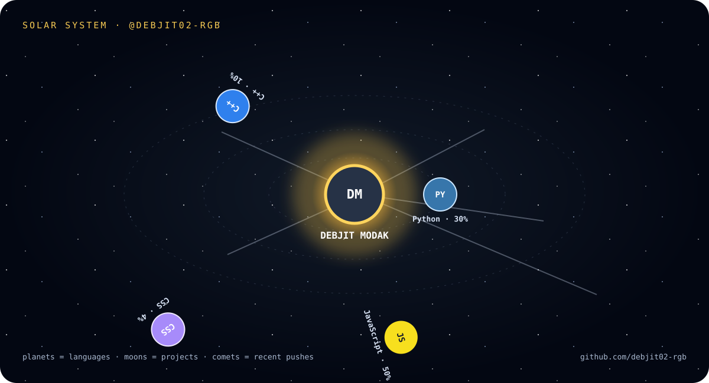

  

  

 

  <em>I am the sun; my languages are the planets and my projects their moons.</em>

 

## ☀️ The Sun

### Debjit Modak

JavaScript developer building AI-powered products, full-stack applications, and useful tools from Kolkata.

`AI/ML` · `Full-stack` · `Open source` · `Kolkata`

### 🪐 My Orbit

| Planet | Orbit meaning |
| --- | --- |
| Python | AI, data, and automation |
| JavaScript | Web applications and Apollo |
| CSS | Interface design |
| C++ | Algorithms and systems |
| C | Foundations and problem solving |

### ☄️ Recent Comets

VITAL · Apollo · LeetCode · AI Nexus Portfolio

 

  <h2>🚀 Building useful things with AI, data, and the web.</h2>
  
AI/ML enthusiast · Full-stack developer · Open-source learner from Kolkata

## 💫 About Me

- 🚀 I’m currently working on AI-powered projects, including VITAL and my personal AI assistant project, Apollo.
- 🤝 I’m looking to collaborate on AI/ML, RAG, full-stack, and open-source projects.
- 🛠️ I’m looking for help with backend architecture, APIs, system design, and reliable AI applications.
- 🌱 I’m currently learning more about AI/ML, RAG systems, backend development, databases, and modern developer tools.
- 💬 Ask me about AI projects, RAG, GitHub, web development, or the projects I’m building.

## 🌐 Connect with me

## 💻 Tech Stack

`C` `C++` `Python` `JavaScript` `TypeScript` `React` `Node.js` `FastAPI` `Django` `MongoDB` `MySQL` `Redis` `Docker` `AWS` `GitHub Actions`

## 📊 GitHub Stats

  
  

  

  Made with curiosity, code, and a little stardust ✨

